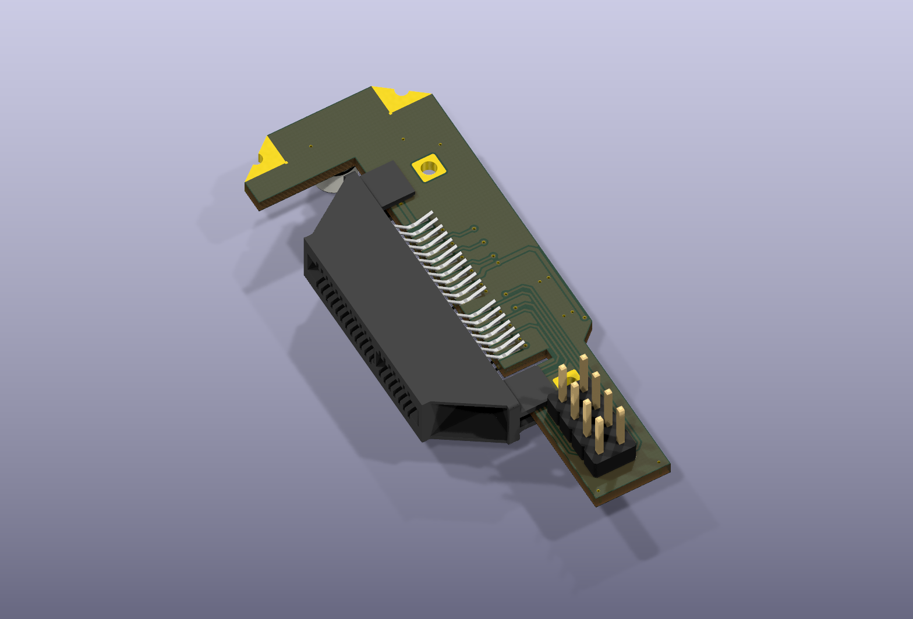
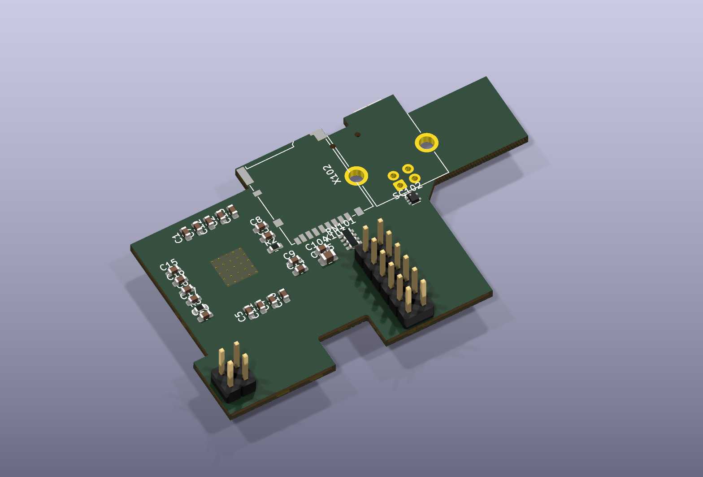

# Forge DSP Hardware

Hardware-Erweiterungen für Forge DSP 96ELN/96ELN-3/96LN und ETON CORE D8, entworfen mit KiCad 10.

| Ordner | Inhalt | Issue |
|---|---|---|
| [`ExtensionPCB/`](ExtensionPCB) | Aufsatzplatine an Position 1 über X-EXT_AUDIO: Modulsteckplatz als Platinenrandstecker Samtec MEC1-120-02-F-D-EM2 (38 Kontakte, Module als 1,6-mm-Steckkarte), U.FL für S/PDIF, liegende FFC-Buchse für X105 (SPI), Lötpad für 12 V vom Meanwell-Netzteil, über Ferrit und Elko gefiltert als VAUX an Kontakt 39/40 | [#1](https://github.com/forge-dsp-community/hardware/issues/1) |
| [`UsbAudioPCB/`](UsbAudioPCB) | Nachbau der USB-Audio/COM-Platine V4.0i des Originals: XMOS XU208 (USB-Audio, I²S/S/PDIF an X104), CP2102 (USB-COM), microSD, QSPI-Flash, Stecker X101/X104 zum Mainboard. Neu: Aussparung über X-PDI für einen Dupont-Stecker. Erzeugt aus `tools/` | [#3](https://github.com/forge-dsp-community/hardware/issues/3) |
| [`forge_es9018_iv_opa_v30/`](forge_es9018_iv_opa_v30) | KiCad-Rekonstruktion der I/V-Ausgangsplatine V3.0 (96ELN) des Originals aus den Eagle-Renderings: LME49740 (I/V-Wandler) und LME49720 (Differenzverstärker), steckt in J1–J4 der AD/DA-Trägerplatine. Netzliste, Platine mit Leiterbahnen, lesbarer Schaltplan | – |

Geplante Einschubmodule: Bluetooth ([#2](https://github.com/forge-dsp-community/hardware/issues/2)),
CAN über MCP2515 ([firmware#73](https://github.com/forge-dsp-community/firmware/issues/73)).

**Stand:** Entwürfe, nicht gefertigt, nicht am Gerät geprüft. Die USB-Audio-Platine ist platziert und geroutet (KiCad-DRC ohne Fehler außer den bekannten Überlappungen von X102/X103/X105/SW101), noch ohne Impedanzprüfung beim Fertiger.

## Ansichten

| | Seite F (KiCad vorne) | Seite B (KiCad hinten) |
|---|---|---|
| ExtensionPCB |  |  |
| UsbAudioPCB |  |  |
| I/V-Ausgang V3.0 |  |  |

3D-Renderings aus KiCad (`kicad-cli pcb render`). Die USB-Audio-Platine sitzt im Forge mit **Seite B nach oben**:
Seite F zeigt zum Mainboard und trägt wie im Original nur microSD-Halter und USB-B-Buchse an der Kante, alle anderen
Bauteile sitzen auf B, die Stiftleisten X101/X104 stecken von B durch die Platine ins Mainboard. Bei der USB-Audio-Platine fehlen noch die Modelle von USB-B-Buchse,
microSD-Halter und Taster.

## USB-Audio-Platine erzeugen

Alles unter `UsbAudioPCB/tools/`, pcbnew-Python von KiCad 10 (`/usr/bin/python3`):

1. `gen_sch.py`, `gen_pcb.py`: Schaltplan und Platine aus `parts.py`/`placement.py`.
2. `fanout.py`: Durchkontaktierungen der Ebenennetze (GND auf In1, +3V3/XMOS.3V3/XMOS.1V0 auf In2).
3. `route_nc.py UsbAudioPCB.kicad_pcb 40 routed.kicad_pcb`: Raster-Router (0,1 mm, 45°) mit PathFinder-Verhandlung,
   gibt je Runde die Konfliktstellen aus und speichert den besten Stand (rund 70 min).
4. `cleanup.py routed.kicad_pcb`: Netze mit DRC-Fehlern neu routen (half beim aktuellen Stand nicht).
5. `fix_route.py`: Handkorrekturen für genau diesen Lauf, danach Zonen füllen und `kicad-cli pcb drc`.

`opt_place.py` sucht Drehungen und Tausche nach Ratsnest-Kreuzungen, `netmap.py` zeichnet Prüfbilder mit Netznamen.

## Anschlüsse der Grundplatine

Belegung von X-EXT_AUDIO, X105 und EXT-SPDIF sowie die Versorgung stehen in
[#1](https://github.com/forge-dsp-community/hardware/issues/1).

## 3D-Modelle

- `ExtensionPCB/Straddle.pretty/FH12-16S-0.5SH.stp` (liegend, eingebaut) und `FH12-16S-0.5SV.stp` (stehend, frühere
  Fassung): FFC-Buchsen von **Hirose Electric Co., Ltd.** (© Hirose, von [hirose.com](https://www.hirose.com/)).
- `ExtensionPCB/Straddle.pretty/MEC1-120-02-F-D-EM2-TR.stp`: Platinenrandstecker MEC1-120-02-F-D-EM2 von
  **Samtec, Inc.** (© Samtec, über [samtec.com](https://www.samtec.com/products/mec1)/TraceParts).

Für beide gelten die Nutzungsbedingungen der Hersteller, nicht die Lizenz dieses Repos. Die übrigen Modelle kommen aus
der KiCad-Bibliothek.

Der Footprint `Samtec_MEC1-120-02-F-D-EM2` ist nach der Samtec-Zeichnung „Recommended PCB layout
MEC1-1XX-XX-XX-D-EMX-XX“ (Rev. H) gezeichnet; die Zeichnung selbst liegt nicht im Repo.

## Lizenz der USB-Audio-Platine

`UsbAudioPCB/` ist ein Nachbau der Platine `pcbs/usb/com_audio/V40i` von **Mark Duprau** (Forge DSP) und steht wie das
Original unter [CC BY-NC-SA 4.0](https://creativecommons.org/licenses/by-nc-sa/4.0/). Abweichungen vom Original sind in
`UsbAudioPCB/tools/parts.py` und `placement.py` mit `PORT` markiert.
