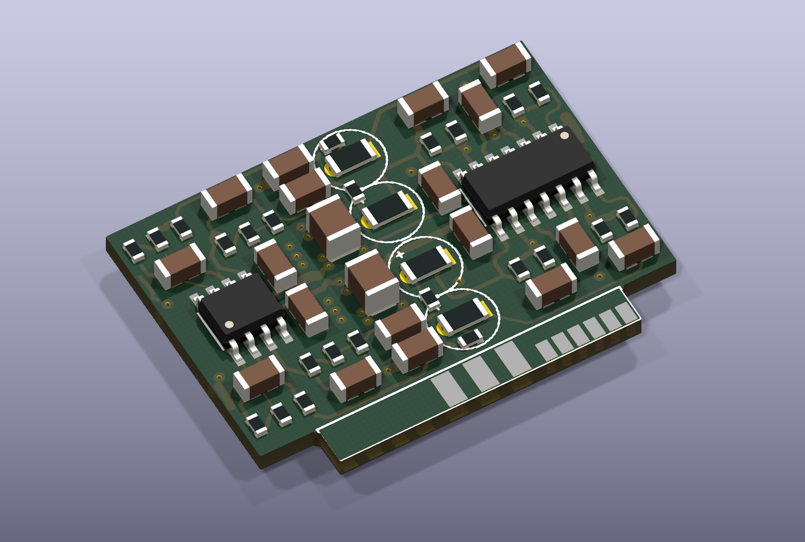
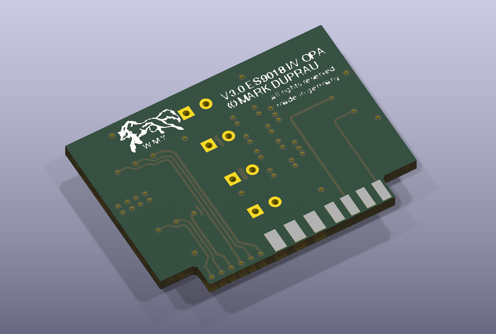

# Forge ES9018 I/V-Ausgangsplatine V3.0 (96ELN) – KiCad-Rekonstruktion

| Seite F | Seite B |
|---|---|
|  |  |

3D-Renderings aus KiCad (`kicad-cli pcb render --rotate '-35,0,±30' --zoom 0.9 --background opaque`). C5…C8 sind wie auf den realen Platinen 0-Ω-Brücken auf den Elko-Plätzen.

## Herkunft

Quelle: `forge/pcbs/output/eln/V30` (bitbucket.org/forge-dsp/pcbs, Mark Duprau, Lizenz CC BY-NC-SA 4.0).
Diese Rekonstruktion steht unter derselben Lizenz.

Diese I/V-Ausgangsplatine wird in einen der 4 Steckplätze J1–J4 der AD/DA-Trägerplatine gesteckt
(siehe `../forge_es9018_pcm4202_ad_v40`). Dort sitzt der ES9018 bzw. ES90x8.
Die Platine wandelt zwei differentielle DAC-Stromausgänge in zwei symmetrische Spannungsausgänge um.

## Schaltung (je Kanal, Kanal 2 / Kanal 1)

| Stufe | Bauteile | Wert |
|---|---|---|
| I/V-Wandler (+ Eingang an I.x-VREF) | R1/R2 bzw. R5/R6 (Rückkopplung) | 2720R 0.1% 10ppm |
| | R102…R105 + C116…C119 (Serienglied parallel zur Rückkopplung) | 100R 0.1% + 100pF C0G |
| Elkoplatz, mit 0R überbrückt (nur V30) | C5…C8 zwischen I/V-Ausgang und 470R | Auf realen Platinen mit 0-Ω-SMD (1206) auf den THT-Pads bestückt statt mit Elko |
| Filter | R106…R109 / C1…C4 | 470R 0.1% / 100nF C0G |
| Differenzverstärker | R114…R117 (Eingang), R110…R113 (Rückkopplung bzw. nach AGND) | 20R 1% / 360R 0.1% |
| | C122…C125 + R3, R4, R7, R8 | 3.9nF C0G + 100R 0.1% |
| VREF-Abblockung | C9, C10 | Wert im Original nicht angegeben |
| Versorgung | C110…C115 | 100nF 16V |

Steckzunge X1 (13 Kontakte, links → rechts): O.2+, O.2−, O.1+, O.1−, −12V, GND, +12V, I.1−, I.1−VREF, I.1+, I.2−, I.2−VREF, I.2+.
O.x− und GND liegen auf AGND.

## Vorgehen

* Quelle sind nur die Eagle-Renderings im Repo (300 dpi): Kupferlagen, Vias, Durchsteckpads (`PADS`), Bestückungsdruck, das Gesamtbild und das Schaltplanbild. Gerber-Bilder gibt es für diese Platine nicht.
* SMD-Pads und Bauteilmitten stammen aus dem Gesamtbild, SOIC-Gehäuse aus den Pinreihen.
  Die Opamp-Ausrichtung ergibt sich aus den ±12-V-Kontakten der Steckzunge.
* Netze ergeben sich aus den Kupfer-Inseln je Lage, verbunden über Vias.
* **Referenzen und Werte** wurden über die Schaltungstopologie den Originalbezeichnungen zugeordnet.
  Beispiel: Ein Widerstand zwischen dem − Eingang und dem Ausgang einer I/V-Sektion ist R1/R2/R5/R6.
  Alle 48 passiven Bauteile des Original-Schaltplans wurden gefunden und zugeordnet.
* Kupfer liegt als **Leiterbahnen** vor (463 Leiterbahn-Segmente, 66 Flächen-Zonen). Breite Flächen (im Original Eagle-Polygone, auch Via-Felder) sind **Zonen mit Netz**, die KiCad selbst füllt (Clearance 0,08 mm, Thermals an THT-Pads). Schaltplan und Platine sind verknüpft.
  Erzeugt mit `rekonstruktion/tracks.py` aus `polys.json`:
  Jede Kupferinsel wird mit 25 px/mm gerastert. Flächen werden über den Distanz-Transform erkannt (morphologisches Öffnen), der Rest wird skelettiert (Zhang-Suen), in Pfade zwischen End- und Knotenpunkten zerlegt, mit Douglas-Peucker vereinfacht, kurze Sporne fallen weg.
  Spurbreite = 2 × Distanz-Transform (Median), abgerundet auf Eagle-Breiten (0,1524 … 1,016 mm) und zusätzlich so begrenzt, dass Clearance zu fremdem Kupfer und Randabstand passen. Über das eigene Kupfer hinaus darf eine Spur höchstens bis zur Hälfte der Lücke zum Nachbarn ragen.
  Endpunkte an Pads/Vias desselben Netzes rasten auf die Pad-/Via-Mitte ein, an Flächen werden sie 0,3 mm hinein verlängert.
  Fläche wird, was einschließlich Pads und Vias ≥ 1,2 mm breit ist, dazu angrenzendes Kupfer ab 0,9 mm Breite. Danach rastert das Skript die erzeugten Spuren und vergleicht sie mit dem Originalkupfer (Formprüfung): Bleibt ein dicker Bereich (≥ 0,3 mm dick, ≥ 0,15 mm²) unbedeckt, wird er mit 0,5 mm Umgebung zur Fläche und die Insel neu berechnet. So werden Via-Felder Flächen statt Haufen kurzer breiter Spuren.
  Die Bild-Pads sind oft größer als die Footprint-Pads, manche Vias liegen direkt am Pad. Was nach dem Skelett innerhalb einer Insel noch getrennt ist, verbindet das Skript deshalb über einen kürzesten Weg durch das Originalkupfer.
  Zum Schluss prüft das Skript mit dem KiCad-DRC und macht Spuren mit Clearance- oder Randfehlern schrittweise schmaler. Spuren, die schon 0,1 mm breit sind, schiebt es um das fehlende Stück vom Hindernis weg.
  Die frühere Zonen-Fassung liegt als `rekonstruktion/forge_es9018_iv_opa_v30_zonen.kicad_pcb` bei. Neu erzeugen mit `/usr/bin/python3 rekonstruktion/tracks.py .`; das Skript liest immer die Zonen-Fassung.

## Prüfung

* DRC (`kicad-cli pcb drc --refill-zones --schematic-parity`): keine offenen Verbindungen, keine Kurzschlüsse, keine Clearance-Fehler, Schaltplan-Abgleich ohne Abweichungen, also wie mit den Zonen.
  Warnungen: 12 × Druck über Kupfer bzw. am Rand (Original-Bestückungsdruck), 4 × „Leiterbahn mit offenem Ende“. Das sind Sackgassen im Originalkupfer (Masse-Randstreifen, AGND-Finger).
* ERC: 0 Verstöße

## Schaltplan

`rekonstruktion/sch_layout.py` ordnet den aus `sch.py` erzeugten Schaltplan neu an (A3):

* OpAmps sind IC-Kästen mit allen 8 bzw. 14 Pins in Gehäusefolge (links 1…4 bzw. 1…7 von oben, rechts gegenläufig). Die Symbole `OPA_DUAL`/`OPA_QUAD` in `forge_iv_opa.kicad_sym` wurden dafür ersetzt.
* Je OpAmp-Sektion liegt die Rückkopplung (R, RC-Glied) außen neben ihren drei Pins, auf der Seite des Ausgangs. Vom Ausgang laufen Koppel-C, Filterwiderstand und Filterknoten mit Querkondensator in einer Reihe nach außen. Die Eingangsbeschaltung liegt auf der anderen Seite.
* Die Abblockkondensatoren hängen per Draht am V+/V−-Pin des OpAmps, an dem sie auf der Platine sitzen.
* Globale Labels gibt es nur zwischen den Gruppen (OpAmp-Blöcke und Steckzunge X1). Versorgung erscheint als Power-Symbole.
* Verdrahtete Netze tragen ihren Namen als lokales Label (`/NAME`). Die Netznamen der Platine sind daran angeglichen (`sch_layout.py <projekt> --pcb`, ändert `.kicad_pcb` und die Zonen-Sicherung). Der DRC mit Schaltplan-Abgleich ist ohne Abweichung.
* Die Netzliste ist geprüft identisch mit der vorherigen Label-Fassung (`rekonstruktion/<name>_labels.kicad_sch`). Die ERC ist ohne Fehler.

## Hinweise

* 2 Lagen. **U2 = LME49740** (Quad, SOIC-14, alle 4 I/V-Stufen, V+ an Pin 4, V− an Pin 11).
  **U1 = LME49720** (Dual, SOIC-8, Differenzverstärker beider Kanäle, V+ an Pin 8, V− an Pin 4).
  Die Typen stammen vom Nutzer. Die Pinbelegung ist gegen beide Datenblätter geprüft (LME49720 von TI, LME49740 von National, Connection Diagram):
  V+/V− und alle + Eingänge (VREF) bzw. − Eingänge (I.x±) liegen auf den Pins, die die Datenblätter angeben.
  Das Datenblatt-Feld ist in Symbol und Footprint eingetragen.
* C5…C8 sind im Bestückungsdruck Elko-Plätze (Plus zum 470R, quadratisches Pad Minus). Auf realen Platinen sitzt dort aber ein 0-Ω-SMD-Widerstand, die I/V-Stufen sind also DC-gekoppelt; den Gleichanteil hebt der Differenzverstärker auf. Schaltplan (Symbol R, Wert „0R (Brücke)“), Footprint `R_0R_auf_Elkoplatz_TH_P2.55` (Elko-Pads, 3D-Modell 1206) und die Generatoren (`outnaming.py`, `pcb.py`, `sch.py`, `models3d.py`) bilden das ab. Die Netze IVx±/IVx±_AC bleiben getrennt benannt.
* Die Symbole sind generische Dual-/Quad-OpAmp-Symbole (IC-Kasten mit allen Pins in Gehäusefolge) mit den Pinfunktionen nach Datenblatt; der Wert trägt den Typ.
* Einige SMD-Pads liegen teilweise unter dem Bestückungsdruck. Ihre Größe ist aus dem Bild geschätzt (±0,05 mm); die Pad-Mitten passen zum Kupfer.
* Skripte und Modell liegen in `rekonstruktion/`. Neu erzeugen mit `build_out.sh V30` (ergibt die Zonen-Fassung), danach `rekonstruktion/forge_es9018_iv_opa_v30_zonen.kicad_pcb` löschen und `/usr/bin/python3 rekonstruktion/tracks.py .` ausführen; die Pfade in `build_out.sh` zeigen auf das temporäre Arbeitsverzeichnis der Sitzung.
