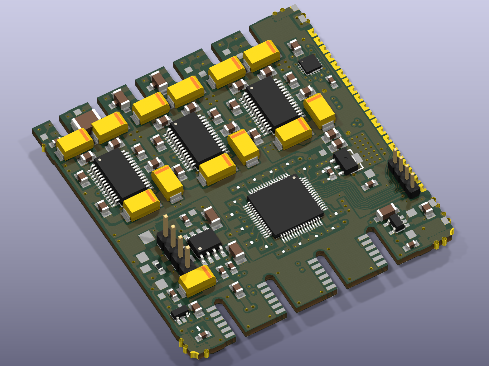
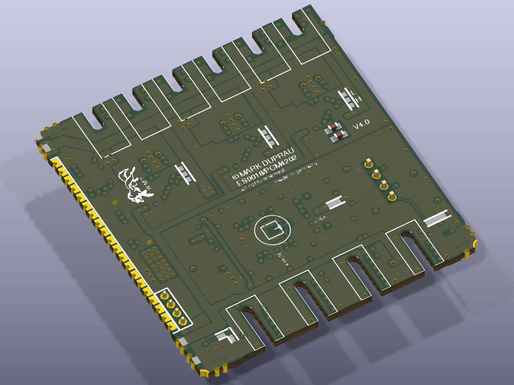

# Forge ES9018/PCM4202 AD/DA V4.0 – KiCad-Rekonstruktion

> **Unfertiger Zwischenstand, nicht poliert.** Die Rekonstruktion stammt aus 300-dpi-Bildern und ist nicht gegen eine echte Platine geprüft. Es fehlen noch 6 Verbindungen, viele Bauteilwerte sind unbekannt, die Bauteilnamen sind neu vergeben und der DRC meldet Kosmetik (Details unten). Nicht zum Fertigen verwenden.

| Unterseite (Bauteile) | Oberseite |
|---|---|
|  |  |

3D-Renderings aus KiCad (`kicad-cli pcb render --rotate '-35,0,±30' --zoom 0.9 --background opaque`).

Quelle: `forge/pcbs/ad_da/eln_ad_da/V40` (bitbucket.org/forge-dsp/pcbs, Mark Duprau,
Lizenz CC BY-NC-SA 4.0). Diese Rekonstruktion steht unter derselben Lizenz.

Das ist die **zentrale AD/DA-Trägerplatine** der Forge DSP 96ELN / ETON CORED8 (V40):
3× PCM4202 (ADC), 1× ES9018 (8-Kanal-DAC), PCA9554 (I²C-Expander). Die analogen
I/V-Ausgangsplatinen (`output/eln/V30`, `output/eln-3/…`) werden in die 4 Steckplätze
J1–J4 gesteckt, die Eingangsplatinen in die 6 Schlitze an der Oberkante.

## Dateien

| Datei | Inhalt |
|---|---|
| `forge_es9018_pcm4202_ad_v40.kicad_pro/.kicad_sch/.kicad_pcb` | KiCad-10-Projekt |
| `forge_ad_da.kicad_sym` | Projekt-Symbole (PCM4202, ES9018, PCA9554, generische) |
| `forge_ad_da.pretty/` | 48 Footprints, Padgeometrie aus den Originaldaten vermessen |
| `rekonstruktion/` | Python-Skripte + `model.json` (Bauteile, Pads, Netze) |

## Ausgangsdaten

Im Repo gibt es **keine echten Gerber/Eagle-Dateien**, nur:

* Eagle-Renderings je Lage (`TOP`, `ROUTE2`, `ROUTE3`, `BOTTOM`, `PADS`, `VIAS`, `HOLES`, `TPLACE`, `BPLACE`, `MILLING`), 300 dpi
* `ES9018-PCM4202_AD.pdf` von Eurocircuits: 4er-Nutzen, Kupferlagen als 300-dpi-Bilder aus den echten Gerbern, Bohrplan mit Bohrtabelle
* das Schaltplanbild `…-SCHEMA.png` (Bus-Darstellung, Netznamen am Bus nicht sichtbar)

## Vorgehen

1. Die Eurocircuits-Bilder werden per Kreuzkorrelation auf die Eagle-Renderings registriert (gedreht um 90°, ±1 px).
2. Kupfer zählt nur dort, wo **beide** Quellen Kupfer zeigen (Eagle um 1 px aufgeweitet). Jede Quelle hat bei 300 dpi eigene 1-px-Brücken; die UND-Verknüpfung entfernt sie.
3. Netze ergeben sich aus den Kupfer-Inseln pro Lage, verbunden über Vias und Durchsteckpads.
4. Pads kommen aus den Lötstopp-Öffnungen (PCB-View Top/Bottom); die ICs werden über Pinraster plus Netzplausibilität eingepasst.
5. Konsistenzprüfung gegen den Original-Schaltplan (`validate.py`, `cmp.py`). Bestätigt sind z. B.:
   * PCM4202: S/M→3V3, FMT0/1→GND, FS0/FS1/HPFD/MCLK/LRCLK/BCLK gemeinsam, SDOUT je Chip getrennt
   * PCA9554 IO0…IO5 = CLIPL.3, CLIPR.3, CLIPL.2, CLIPR.2, CLIPL.1, CLIPR.1, IO6 = nRST.PCM4202, IO7 = RST.ES9018 (genau wie im Original)
   * J1…J4: I.2+, I.2−VREF, I.2−, I.1+, I.1−VREF, I.1− = VOUT2/1 … VOUT8/7 des ES9018
   * X100 Pin 3…16 wie im Original (SDA/SCL.PIPE, AD.OUT.1…3, LOCK, MCLK, BCLK.IN/OUT, LRCLK)
6. Die Bohrungen stimmen 1:1 mit der Eurocircuits-Bohrtabelle überein: Vias 0,25/0,30/0,40/0,50/0,60/0,80 mm, 20× 0,7 mm Halbloch-Kontakte, 4× 1,0 mm, 3× 2,0 mm.

## Ergebnis

* **Platine:** 53,21 × 56,39 mm, 4 Lagen. Umriss mit Schlitzen aus der Fräslage.
  Kupfer auf F/In1/In2/B als **3759 Leiterbahn-Segmente** und **174 Flächen-Zonen** mit Netz (siehe „Kupfer: Leiterbahnen statt Zonen“), dazu 332 Vias, 3 Montagebohrungen und der Bestückungsdruck oben/unten als Grafik.
  Fast alle Bauteile sitzen auf der **Unterseite**.
* **Schaltplan:** 97 Symbole, 103 Netze, Bauteilgruppen verdrahtet, globale Labels nur zwischen Gruppen (siehe Schaltplan). Schaltplan und Platine sind verknüpft; der DRC mit Schaltplan-Abgleich ist fehlerfrei.
* **DRC** (`kicad-cli pcb drc --refill-zones --schematic-parity`): 0 Kurzschlüsse, 0 Clearance-Fehler, **6 offene Verbindungen** (siehe unten), genau wie in der Zonen-Fassung. Der Rest ist kosmetisch und war vorher schon da: 67 × Kupfer am Halbloch-/Platinenrand (Pads und Vias des Randkontakts), 13 Courtyard-Überlappungen, 1 THT-Pad im Courtyard, Druck über Kupfer.
  Neu sind nur Warnungen:
  * 69 × „Leiterbahn mit offenem Ende“, überwiegend Sackgassen im Originalkupfer.
  * 9 × „Via nur einlagig angebunden“: Diese Vias haben auf den übrigen Lagen nur ihren eigenen Ring als Kupfer (~1 mm). Als Zone zählte dieser Ring für KiCad als Verbindung, als Via-Pad nicht mehr; elektrisch ändert sich nichts.

### Kupfer: Leiterbahnen statt Zonen

Kupfer liegt als **Leiterbahnen** vor. Breite Flächen (im Original Eagle-Polygone, auch Via-Felder) sind **Zonen mit Netz**, die KiCad selbst füllt (Clearance 0,08 mm, Thermals an THT-Pads).

Erzeugt mit `rekonstruktion/tracks.py` aus `polys.json`:

* Jede Kupferinsel wird mit 25 px/mm gerastert. Flächen werden über den Distanz-Transform erkannt (morphologisches Öffnen), der Rest wird skelettiert (Zhang-Suen), in Pfade zwischen End- und Knotenpunkten zerlegt, mit Douglas-Peucker vereinfacht, kurze Sporne fallen weg.
* Spurbreite = 2 × Distanz-Transform (Median), abgerundet auf Eagle-Breiten (0,1524 … 1,016 mm) und zusätzlich so begrenzt, dass Clearance zu fremdem Kupfer und Randabstand passen. Über das eigene Kupfer hinaus darf eine Spur höchstens bis zur Hälfte der Lücke zum Nachbarn ragen.
* Endpunkte an Pads/Vias desselben Netzes rasten auf die Pad-/Via-Mitte ein, an Flächen werden sie 0,3 mm hinein verlängert.
* Fläche wird, was einschließlich Pads und Vias ≥ 1,2 mm breit ist, dazu angrenzendes Kupfer ab 0,9 mm Breite. Danach rastert das Skript die erzeugten Spuren und vergleicht sie mit dem Originalkupfer (Formprüfung): Bleibt ein dicker Bereich (≥ 0,3 mm dick, ≥ 0,15 mm²) unbedeckt, wird er mit 0,5 mm Umgebung zur Fläche und die Insel neu berechnet. So werden Via-Felder Flächen statt Haufen kurzer breiter Spuren.
* Die Montagelöcher H1–H3 sind voll an die Flächen angebunden (ohne Thermal): In den Ecken erreicht die Fläche sie nur von einer Seite, mit Thermal bliebe nur ein Steg.
* Die Bild-Pads sind oft größer als die Footprint-Pads, manche Vias liegen direkt am Pad. Was nach dem Skelett innerhalb einer Insel noch getrennt ist, verbindet das Skript deshalb über einen kürzesten Weg durch das Originalkupfer.
* Zum Schluss prüft das Skript mit dem KiCad-DRC und macht Spuren mit Clearance- oder Randfehlern schrittweise schmaler. Spuren, die schon 0,1 mm breit sind, schiebt es um das fehlende Stück vom Hindernis weg.
* Die frühere Zonen-Fassung liegt als `rekonstruktion/forge_es9018_pcm4202_ad_v40_zonen.kicad_pcb` bei. Neu erzeugen mit `/usr/bin/python3 rekonstruktion/tracks.py .`; das Skript liest immer die Zonen-Fassung.

### Offene Punkte (im Original vorhanden, im 300-dpi-Bild zu dünn)

In KiCad erscheinen sie als Luftlinie und müssen von Hand nachgezogen werden:
`AD.OUT.3`, `nRST.PCM4202`, `VINR+.1`, `VINR+.2`, `VINR+.3`, `VOUT4+`.

### Teile, die nicht im Original-Schaltplanbild stehen

| Ref | Gehäuse | Funktion (aus Netzen abgeleitet) |
|---|---|---|
| U201 | SOT-23-5 | LDO 5V0 → **1V2_AVCC** (VDD_L/R des ES9018), Eingang über C254 (Ferrit/R?) |
| U202 | SOT-89 | Regler 3V3.NOHF → **1V2_DVCC** (VDD1–3 des ES9018) |
| U203 | SOIC-8 | Regler für **3V3_AVCC_L / 3V3_AVCC_R** (Eingang von X102.3) |
| U204 | SOT-23 | unbekannt (X102.4, C251/C252/C247) |
| X102 | 1×04, 2,54 mm | Versorgungseingang der Analogregler |
| X101 | 1×04, 2,0 mm | DATA2…DATA5 des ES9018 (Datenkanäle) |

### Unsicherheiten

* **Referenzen:** Der Original-Bestückungsdruck hat keine Namen. IC101…IC105, R10/C35 usw. folgen dem Schaltplan, alle passiven Teile heißen neu **C2xx/R2xx**, Pads ohne erkennbares Bauteil **TPxx**.
* **Werte:** Werte stammen aus dem Original-Schaltplan, zugeordnet über die Funktion (VREF/VCC/VDD-Tantal 47 µF, Abblock 100 nF, Eingang 2,7 nF). Mit `?` markierte Werte sind unbekannt; aus den Bildern lässt sich nicht unterscheiden, ob ein Pad-Paar R, C oder Ferrit ist.
* **Eingangsschlitze (Oberkante):** Bei C207…C212, C259 und TP1…TP4 ist unklar, ob es Kondensatoren oder Lötkontakte der Eingangsplatinen sind. Die 100-pF-Kondensatoren aus dem Schaltplan sitzen vermutlich auf den Eingangsplatinen.
* **Bauteilanzahl:** 71 Footprints mit Pads (ohne Randkontakt, Steckplätze, Jumper, Padgruppen). Ein Teil davon ist auf realen Platinen wohl unbestückt; der V40e-Schaltplan markiert mehrere Kondensatoren als „n.c.“.
* **U.FL (X-MCLK-DA):** Nur der Signalpad (TP17, Netz `MCLK.DA` → ES9018 XI) ist sicher erkannt. Die Massepads liegen in der GND-Fläche.

## 3D-Modelle

* Alle Bauteile haben KiCad-eigene 3D-Modelle (STEP aus `${KICAD10_3DMODEL_DIR}`), eingetragen in `forge_ad_da.pretty` und in der Platine. Fast alles sitzt auf der Unterseite; die Bilder oben zeigen beide Seiten.
* Zuordnung: C_0603 (Pad-Abstand bis 2 mm) → `C_0603_1608Metric` (R201 → `R_0603_1608Metric`), C_0805 → `C_0805_2012Metric`, L_C_1206ish → `C_1206_3216Metric`, Tantal Case C → `CP_EIA-6032-28_Kemet-C`, SSOP-28 (PCM4202) → `SSOP-28_5.3x10.2mm_P0.65mm`, TQFP-64 (ES9018) → `TQFP-64_10x10mm_P0.5mm`, HVQFN-16 (PCA9554) → `WQFN-16-1EP_3x3mm_P0.5mm_EP1.6x1.6mm`, SOIC-8 → `SOIC-8_3.9x4.9mm_P1.27mm`, SOT-23 → `SOT-23`, SOT-23-5 → `SOT-23-5`, SOT-89 → `SOT-89-3`, X101 → `PinHeader_1x04_P2.00mm_Vertical`, X102 → `PinHeader_1x04_P2.54mm_Vertical`.
* C210, C211, C253 und C259 haben 0603-Pads, aber 3,6…4,7 mm Pad-Abstand. Ihr Modell richtet sich nach dem Abstand, damit der Körper auf den Pads liegt: `C_1206_3216Metric` bzw. `C_1812_4532Metric` für C259. Die echte Bauform ist unbekannt.
* U201 (SOT-23-5) und U203 (SOIC-8): Die Pin-Reihenfolge der rekonstruierten Footprints ist gespiegelt. Die Gehäuse sitzen richtig auf den Pads, die Pin-1-Markierung des Modells liegt aber am anderen Ende der Pin-1-Reihe. U204 (`SOT-23-3_custom`) passt nur ungefähr auf die Pads.
* Ohne Modell, weil Kupfer bzw. Bohrung der Platine selbst: Randkontakt X100, Steckplätze J1…J4 für die I/V-Platinen, Lötbrücken JP1…JP3, Bohrungen H1…H3. Die Pad-Gruppen TP1…TP18 haben kein Modell, weil das Bauteil (falls bestückt) unbekannt ist.
* Bilder: `kicad-cli pcb render --side bottom` bzw. `--side top` nach dem Füllen der Zonen.
* Neu setzen nach jedem Neuerzeugen von Bibliothek oder Platine (`pcb.py`, `tracks.py`): `/usr/bin/python3 rekonstruktion/models3d.py .`. Das Skript trägt die Modelle in die Bibliothek, die Platine und `rekonstruktion/<name>_zonen.kicad_pcb` ein.

## Schaltplan

`rekonstruktion/sch_layout.py` ordnet den aus `sch.py` erzeugten Schaltplan neu an (A2):

* Je IC ein Block: Die Kondensatoren eines Pins hängen an einer Drahtbahn direkt am Pin, gestaffelt nach außen, damit sich nichts kreuzt. Kondensatoren zwischen zwei Pins (VIN+/VIN−) stehen senkrecht dazwischen. Abblockkondensatoren hängen am Versorgungspin, an dem sie auf der Platine am nächsten sitzen (seitliche Pins über eine Bahn, Pins oben/unten per Draht).
* Globale Labels gibt es nur für Netze zwischen Blöcken (Takte, I²C, CLIP/Reset, VOUT → J1…J4, Randkontakt). Versorgung erscheint als Power-Symbole.
* Verdrahtete Netze tragen ihren Namen als lokales Label (`/NAME`). Die Netznamen der Platine sind daran angeglichen (`sch_layout.py <projekt> --pcb`). Der DRC mit Schaltplan-Abgleich ist ohne Abweichung.
* Die Netzliste ist geprüft identisch mit der Label-Fassung (`rekonstruktion/<name>_labels.kicad_sch`). Die ERC zeigt nur noch die 15 Warnungen zu Ein-Pin-Netzen, die es vorher auch gab.

## Neu erzeugen

`rekonstruktion/run_all.sh`, dann `polys.py`, `pcb.py <ordner> <name>` und `sch.py <ordner> <name>`, danach `/usr/bin/python3 rekonstruktion/sch_layout.py .` (Schaltplan anordnen). Das ergibt die Zonen-Fassung.
Dann `rekonstruktion/forge_es9018_pcm4202_ad_v40_zonen.kicad_pcb` löschen und `/usr/bin/python3 rekonstruktion/tracks.py .` ausführen (sichert die neue Zonen-Fassung und erzeugt die Leiterbahnen).
Danach `kicad-cli pcb drc --refill-zones --save-board --schematic-parity` ausführen.
Die Skripte lesen ihre Pfade aus Umgebungsvariablen: `FORGE_PCBS` (Checkout von forge-dsp/pcbs), `REK_TOOLS` (Ordner mit den Extraktionsskripten), `SDIR` (Arbeitsordner für Zwischenstände).
